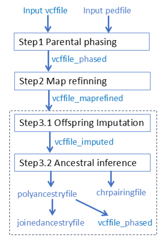

# Understand output

## Overview

PolyOrigin produces in total 8 files
1. oustem.log: log file containing input argument values and computational time. 
2. outstem_plots.tar collects all figured plotted in all the three steps of PolyOrigin
3. outstem_maprefined.vcf.gz: same as the input genofile except that parents are phased and map is refined
4. outstem_imputed.vcf.gz: same as the input genofile except that parents are phased, offspring are imputed, and map is refined
5. outstem_phased.vcf.gz: same as the input genofile except that parents and offspring are phased and map is refined
6. outstem_chrpairing.csv: inference results on chromosomal pairing 
7. outstem_polyancestry.csv.gz: main results from ancestor inference
8. outstem_joinedancestry.csv.gz: polyacestry with joined state space

In the following, we will describe polyancestry file and joinedancestry file, each of which contains a collection of dataframes. 

## polyacnestry file

The output `polyancestryfile` is a CSV file containing a list of dataframes:

1. `pedigree`: pedigree information 
2. `valentlist`: list of valent configurations for each full-sib family
3. `valentprob`: posterior probabilities of valent configurations for all individuals except founders
4. `parentgeno`: phased genotpyes for all founders and intermediators that are both parents and offspring. 
5. `offspringgeno`: phased genotpyes for leaf offspring that have no progeny. 
6. `unphasedstate`: list of possible unphased origin-genotypes for each family. 
7. `phasedstate`: list of possible phased origin-genotypes for each family.
8. `viterbipath`: best phased origin-genotypes at all markers for each individual, resulting from the Viterbi algorithm. 
9. `diploprob`: marginal posterior probaiblities of phased origin-genotypes at each marker for each individual, resulting from the forward-backward algorithm. 
10. `genoprob`: marginal posterior probaiblities of unphased origin-genotypes derived from the above `diploprob`. 
11. `haploprob`: marginal posterior probaiblities of parent origins derived from the above `diploprob`. The posterior probabilities are unormalized and summed to the correponding ploidy. 

In polyancestryfile, the possible origin-genotypes of an offspring (or an intermediator) are defined in terms of the parental origins of its immediate parents. The parental origins of the 1st parent (mother) are denoted by 1, 2,..., $k_1$ for the $k_1$ homologs of the parent. If the offspring is not self-fertilized,  the parental origins of the 2nd parent (father) are denoted by $k_1$+1, $k_1+2$, ..., $k_1+k_2$ for the $k_2$ homologs of the parent. Thus, the definitions of `phasestate` and `unphasestate` are family-specific. 

## joinedacnestry file

The output `joinedancestryfile` is a CSV file containing a list of dataframes:

1. `pedigree`: pedigree information 
2. `joinedspace`: definition of founder origins. 
3. `foundergeno`: phased founders' genotypes, resulting from parental phasing and correction.
4. `offspringgeno`: phased genotpyes for leaf offspring that have no progeny. 
5. `viterbipath`: best phased origin-genotypes at all markers for each individual, derived from `viterbipath` of `polyancestryfile`. 
6. `diploprob`: marginal posterior probaiblities of phased origin-genotypes at each marker for each individual, obtained by 1000 random samples from `diploprob` of `polyancestryfile`. 
7. `genoprob`: marginal posterior probaiblities of unphased origin-genotypes, derived from the above `diploprob`. 
8. `haploprob`: marginal posterior probaiblities of founder origins derived from the above `diploprob`. The posterior probabilities are unormalized and summed to the correponding ploidy. 

In joinedancestryfile, the possible origin-genotypes of an offspring (or an intermediator) are defined in terms of the founder origins of all founders (see `joinedspace`). The founder origins of the i-th founder are denoted by $s_i$+1, $s_i$ + 2,..., $s_i + k_i$ for its $k_i$ homologs, where $s_i$ is the accumulated sum of ploidies over founders coming before founder $i$ and it is given by $s_1$ = 0 and $s_i = \sum_{j=1}^{i-1} k_j$ for $i > 1$. 
